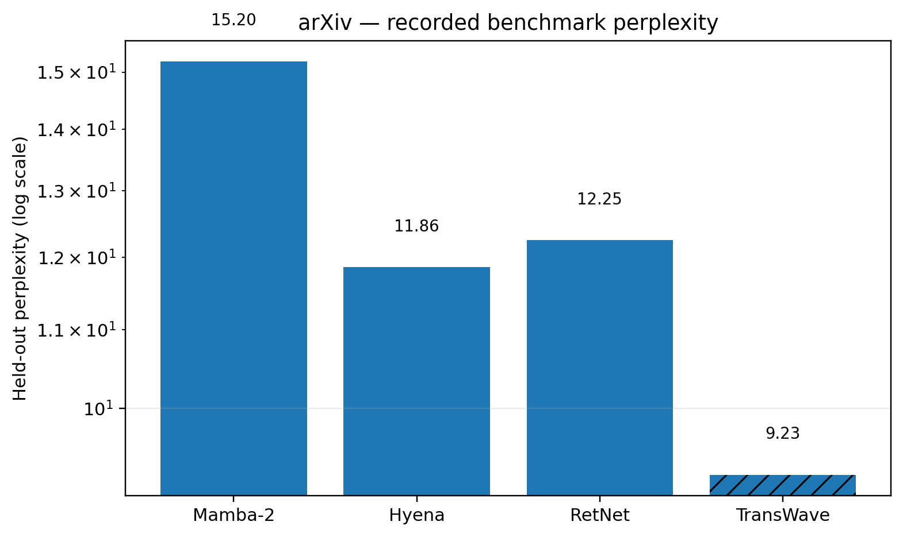
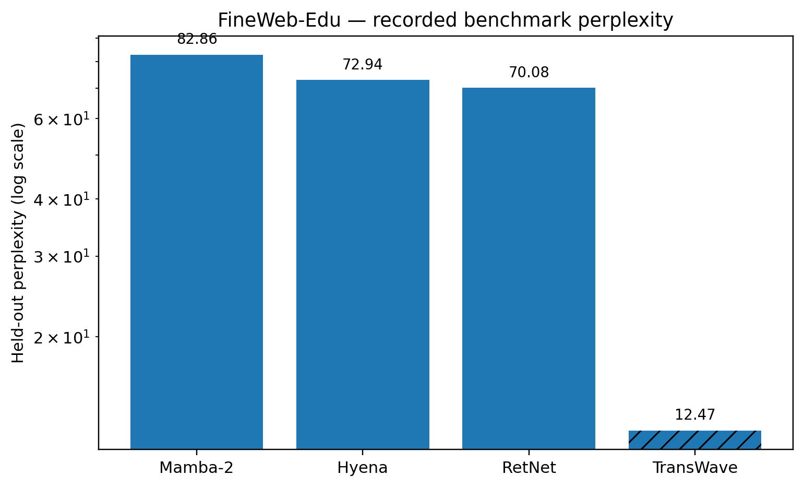
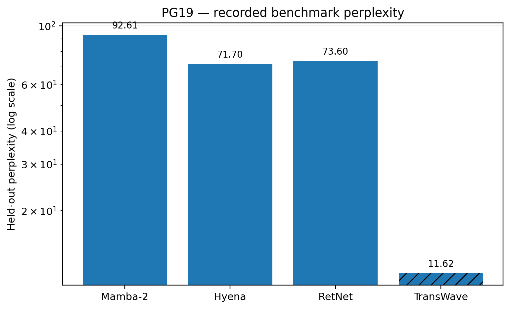
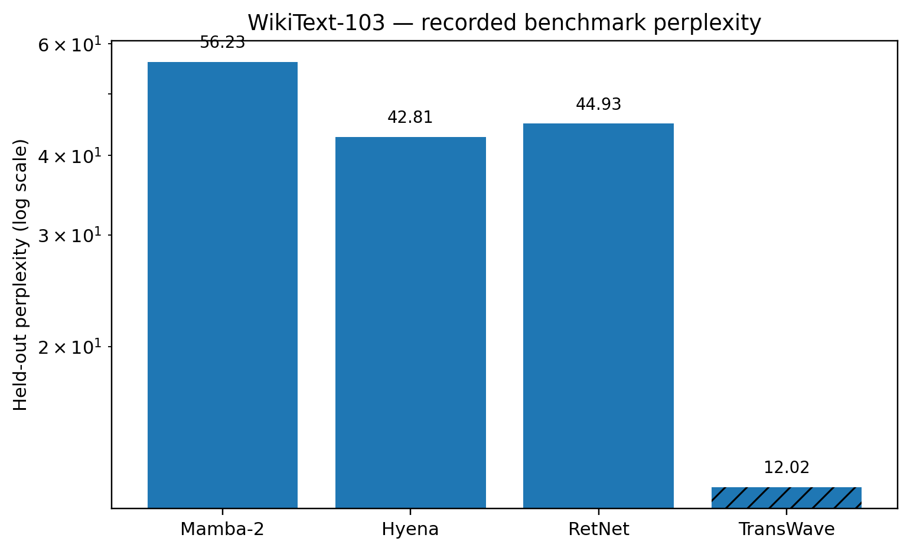

# TransWave

**A causal multiscale raw-byte language model built from learned lifting, cross-scale mixing, causal Meyer spectral operators, and a short-memory causal local path.**

TransWave asks a simple architecture question: can a language model obtain strong long-range sequence modeling without making self-attention its central operator?

The final model in this repository has **96,130,040 parameters**, consumes raw UTF-8 bytes directly, uses a **32,768-byte context**, and optimizes the exact autoregressive objective `p(x_t | x_<t)`.

## At a glance

| Property | Final TransWave |
|---|---:|
| Parameters | **96,130,040** |
| External tokenizer | **None** |
| Vocabulary | **256 raw bytes** |
| Raw context | **32,768 bytes** |
| Block size | 8 bytes |
| Model width | 768 |
| Layers | 12 |
| Learned scales | 8 |
| Meyer bands | 12 |
| Causal Meyer FIR | 512 blocks |
| Local causal memory | kernel 7 |
| FFN | SwiGLU 2,816 |
| Objective | exact causal next-byte likelihood |

The model contains two complementary memory paths: a short strictly causal depthwise convolution and a much longer causal Meyer spectral operator. An autoregressive GRU decoder performs the exact eight-byte factorization inside each block.

## Final causal TransWave results

These are the final held-out causal next-byte results saved by the frozen architecture `causal_transwave_blocklifting_meyer_byte_lm_g4_v2`.

| Dataset | NLL ↓ | PPL ↓ | BPB ↓ |
|---|---:|---:|---:|
| arXiv | **2.222877** | **9.233854** | **3.206933** |
| FineWeb-Edu | **2.523234** | **12.468853** | **3.640257** |
| PG19 | **2.452323** | **11.615302** | **3.537955** |
| WikiText-103 | **2.486348** | **12.017311** | **3.587042** |

## Recorded comparisons with prominent standalone Transformer alternatives

We use Mamba-2, Hyena, and RetNet as representative high-profile alternatives to standard attention-based Transformers. Mamba-2 develops structured state-space duality and reports competitive language modeling; Hyena is proposed as a subquadratic drop-in replacement for attention and reported state-of-the-art dense-attention-free language modeling; RetNet is proposed as a foundation architecture combining parallel training with recurrent or chunkwise-recurrent inference.

### arXiv

| Method | Parameters | NLL ↓ | PPL ↓ |
|---|---:|---:|---:|
| Mamba-2 | 126,291,296 | 2.721178 | 15.198222 |
| Hyena | 111,416,576 | 2.472997 | 11.857936 |
| RetNet | 117,711,872 | 2.505527 | 12.250016 |
| **TransWave** | 96,130,040 | **2.222877** | **9.233854** |



### FineWeb-Edu

| Method | Parameters | NLL ↓ | PPL ↓ |
|---|---:|---:|---:|
| Mamba-2 | 126,291,296 | 4.417161 | 82.860734 |
| Hyena | 111,416,576 | 4.289595 | 72.936943 |
| RetNet | 117,711,872 | 4.249693 | 70.083923 |
| **TransWave** | 96,130,040 | **2.523234** | **12.468853** |



### PG19

| Method | Parameters | NLL ↓ | PPL ↓ |
|---|---:|---:|---:|
| Mamba-2 | 126,291,296 | 4.528377 | 92.608091 |
| Hyena | 111,416,576 | 4.272470 | 71.698544 |
| RetNet | 117,711,872 | 4.298588 | 73.595795 |
| **TransWave** | 96,130,040 | **2.452323** | **11.615302** |



### WikiText-103

| Method | Parameters | NLL ↓ | PPL ↓ |
|---|---:|---:|---:|
| Mamba-2 | 126,291,296 | 4.029364 | 56.225123 |
| Hyena | 111,416,576 | 3.756758 | 42.809413 |
| RetNet | 117,711,872 | 3.804997 | 44.925102 |
| **TransWave** | 96,130,040 | **2.486348** | **12.017311** |



**Protocol note.** The three historical baselines above were trained under the earlier tokenized 15% masked-language-model protocol, whereas the final TransWave numbers are exact causal raw-byte next-byte likelihoods. The table therefore reports the numerical results recorded in our experiments; it should not be interpreted as a controlled objective-identical comparison. The exact per-run JSON records are included in `benchmarks/final_causal_results`.

## Final causal convergence

The stored validation histories show steady improvement across all four corpora.

- [arXiv validation curve](figures/validation_curves/arxiv_validation_curve.png)
- [FineWeb-Edu validation curve](figures/validation_curves/fineweb_edu_validation_curve.png)
- [PG19 validation curve](figures/validation_curves/pg19_validation_curve.png)
- [WikiText-103 validation curve](figures/validation_curves/wikitext103_validation_curve.png)

## Architecture

```text
raw UTF-8 bytes
      │
      ▼
learned 8-byte block-local lifting
      │
      ▼
8-scale representation
      │
      ├──────── short-memory path ────────► causal depthwise conv (k=7)
      │
      └──────── long-memory path ─────────► scale mix
                                             │
                                             ▼
                                      causal Meyer FIR
                                        (512 blocks)
                                             │
                                             ▼
                                          scale mix
      │
      ▼
gated residual fusion
      │
      ▼
SwiGLU feed-forward
      │
      ▼
12 stacked TransWave layers
      │
      ▼
one-block causal shift
      │
      ▼
8-byte autoregressive GRU decoder
      │
      ▼
p(x_t | x_<t)
```

See [`docs/architecture.md`](docs/architecture.md) and the exact implementation in [`src/transwave_architecture.py`](src/transwave_architecture.py).

## 4.5B-token release pretraining

The release training recipe targets exactly **4,499,996,672 raw-byte tokens** = 137,329 complete 32,768-byte contexts.

The G4 runtime used by the active release run selected physical batch **144** with a 3 GiB safety margin. The full protocol is checked in under `release/`.

Run the Colab notebook:

[`training/TransWave_Meyer_96M_4p5B_HF_Pretrain_G4.ipynb`](training/TransWave_Meyer_96M_4p5B_HF_Pretrain_G4.ipynb)

The notebook is restart-safe, checkpoints to Google Drive, performs a complete-step VRAM probe, and exports a weight-only Hugging Face directory after training.

## Repository layout

```text
TransWave_GitHub_Release/
├── README.md
├── CITATION.cff
├── references.bib
├── requirements.txt
├── src/
│   └── transwave_architecture.py
├── training/
│   ├── train_4p5b.py
│   └── TransWave_Meyer_96M_4p5B_HF_Pretrain_G4.ipynb
├── benchmarks/
│   ├── causal_benchmark_reference.py
│   ├── final_causal_results.csv
│   ├── comparison_tables.csv
│   └── final_causal_results/
├── figures/
│   ├── benchmarks/
│   └── validation_curves/
├── scripts/
│   └── make_figures.py
├── release/
│   ├── training_config_4p5b.json
│   ├── g4_batch_plan.json
│   └── data_manifest_summary.json
└── docs/
    ├── architecture.md
    └── model_card.md
```

## Reproducing the figures

```bash
python scripts/make_figures.py
```

## Baseline references

1. Tri Dao and Albert Gu. **Transformers are SSMs: Generalized Models and Efficient Algorithms Through Structured State Space Duality.** ICML 2024. https://proceedings.mlr.press/v235/dao24a.html
2. Michael Poli et al. **Hyena Hierarchy: Towards Larger Convolutional Language Models.** ICML 2023. https://proceedings.mlr.press/v202/poli23a.html
3. Yutao Sun et al. **Retentive Network: A Successor to Transformer for Large Language Models.** arXiv:2307.08621, 2023. https://arxiv.org/abs/2307.08621

## Citation

If you use TransWave, please cite the repository using `CITATION.cff`.

---

**TransWave is intentionally not another attention approximation.** It treats sequence modeling as a causal multiscale signal-processing problem and learns the lifting, scale interaction, spectral memory, local memory, and byte-level decoder jointly.
